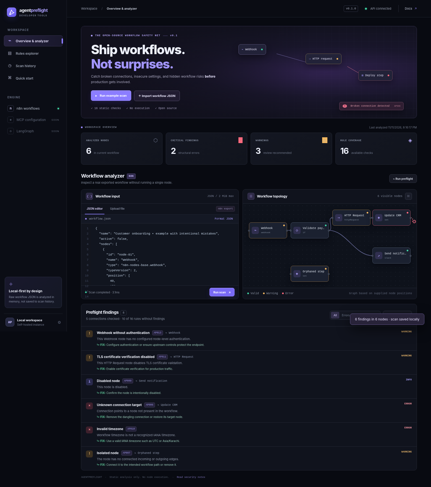
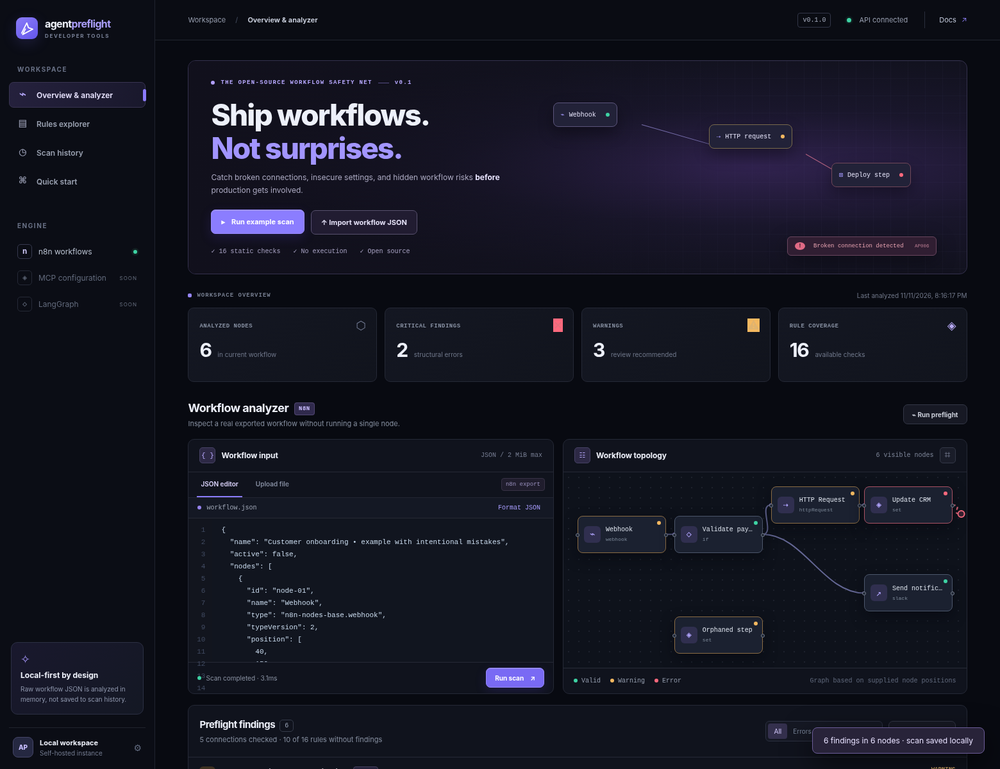
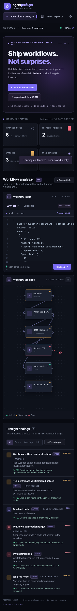

<div align="center">

# ✦ AgentPreflight

### Catch broken AI workflows before production.

**Inspect · Validate · Understand · Ship**

A local-first, open-source preflight analyzer for n8n workflows. Catch broken connections, unreachable nodes, and risky configurations **without executing your automation**.

[Get started](#run-in-60-seconds) · [Self-host](docs/SELF_HOSTING.md) · [Documentation](docs/README.md) · [Contribute](CONTRIBUTING.md) · [Roadmap](docs/ROADMAP.md)

**TypeScript** · **16 static rules** · **Browser dashboard + CLI + HTTP API** · **MIT licensed**

</div>



<sub>Screenshot from the included web app, running against the real local API and intentionally broken n8n example fixture. The example reports 2 errors, 3 warnings, and 1 informational finding. Screenshots demonstrate local functionality; no public demo URL is claimed.</sub>

## Why AgentPreflight?

AI and automation workflows are increasingly deployed with external services, credentials, triggers, and connected tools. A workflow may look correct in an editor but contain a dangling node connection, a disabled operation, an invalid timezone, or risky HTTP settings.

**AgentPreflight checks an exported workflow before deployment.** It turns structural and configuration issues into reproducible diagnostics: what failed, where it happened, and what to investigate next.

Think of it as a lightweight pre-commit check for automation workflows—not a replacement for integration tests or production observability.

## When should you use it?

- **Before deployment:** run a preflight check on an exported n8n workflow to catch structural mistakes.
- **During code review:** attach a JSON or Markdown diagnostic report to discussions about a changed workflow.
- **In local CI:** fail a build when a scan detects errors, or use warning thresholds for stricter policies.
- **While debugging:** inspect the graph to identify disconnected paths, broken references and suspicious settings.
- **For teaching:** learn how directed graphs, deterministic validation rules, and developer-facing diagnostics work together.

AgentPreflight is a **preflight layer**, not a runtime simulator, security certification, or replacement for staging tests.

## What can it do today?

| Capability | Status | Notes |
| --- | --- | --- |
| Import exported n8n workflow JSON | ✅ Included | Paste JSON or upload a file |
| Run 16 deterministic static rules | ✅ Included | Errors, warnings, informational findings |
| Visualize the workflow graph | ✅ Included | Basic node layout, connections, finding indicators; up to 400 rendered nodes |
| Inspect actionable diagnostics | ✅ Included | Rule IDs, affected nodes, suggested fixes |
| Review and delete local scan history | ✅ Included | Only scan summaries and diagnostics are stored |
| Export scan reports | ✅ Included | JSON in UI; Markdown through API or CLI |
| Scan via command line / CI | ✅ Included | Configurable failure thresholds |
| Self-host via Docker Compose | ✅ Included | Loopback-only port by default |
| Connect to a live n8n instance | 🗓️ Planned | Not required to scan exported files |
| Verify real credentials / run workflows | 🗓️ Planned | Not implemented, never implied |
| MCP / LangGraph adapters | 🗓️ Planned | n8n is the current supported input |

## Run in 60 seconds

Requires **Node.js 22+** and **npm**.

Download or clone the source, then from the project root:

```bash
npm install
npm test
npm run dev
```

Open **http://127.0.0.1:8787**.

1. Click **Run example scan** to see a real analysis using a deliberately broken sample.
2. Explore the graph and diagnostics, including affected nodes and recommended fixes.
3. Import your own exported n8n JSON to run the same checks locally.

> **Important:** This version serves its own standalone, functional reference web UI from `public/`. The original separately generated Next.js frontend has **not** been merged or verified. An optional Next.js integration adapter is included in `integrations/nextjs/`.

### Run the CLI

```bash
npm run build
node dist/src/cli.js scan fixtures/demo-workflow.json --fail-on never
node dist/src/cli.js scan fixtures/valid-workflow.json --format markdown
node dist/src/cli.js scan fixtures/broken-workflow.json --format json --fail-on warning
```

Exit codes: `0` = no findings at the configured threshold; `1` = threshold reached; `2` = invalid input/usage. The CLI runs offline and does not need the HTTP server.

### 🐳 Self-host with Docker

```bash
docker compose up --build -d
```

Open **http://127.0.0.1:8787**. Data is saved to a named Docker volume. To stop it:

```bash
docker compose down
```

**Do not expose v0.1.0 directly to the internet.** This local prototype has no authentication, rate limiting, or user isolation. The included Compose configuration publishes only to `127.0.0.1`. See [complete self-hosting and safety instructions](docs/SELF_HOSTING.md).

### REST API quick example

```bash
curl -X POST http://127.0.0.1:8787/api/scans \
  -H 'Content-Type: application/json' \
  --data '{"workflow":{"nodes":[],"connections":{}}}'
```

See [HTTP API reference](docs/API.md) for all eight endpoints, payload limits, and examples.

## Screenshots

| Desktop dashboard | Mobile layout |
| --- | --- |
|  |  |

Both screenshots come from the same locally running application using the example fixture. No user data or credentials were used.

## What gets checked?

Some of the current validations include:

- **Structure** — invalid node objects, missing identity fields, duplicate names and IDs.
- **Connections** — unknown sources, dangling targets, malformed connection structures.
- **Graph health** — isolated nodes, unreachable paths from known triggers, disabled nodes.
- **Configuration** — invalid timezone names and potential embedded secrets.
- **Security hygiene** — disabled TLS verification, command-execution nodes, unauthenticated webhooks.
- **Credentials** — malformed credential reference *shapes* only; **not** whether a referenced credential actually exists.

Findings are best-effort static analysis, not proof that a workflow is safe or broken in every environment. [View all 16 rules](docs/RULES.md).

## Architecture

```text
Browser reference UI (public/)      CLI (src/cli.ts)
            │                            │
            ▼                            ▼
   HTTP API (src/server.ts) ─────► Shared TypeScript rule engine
            │                      (src/engine/)
            ▼
     Local scan store
  (.agentpreflight-data/)
      summaries only
```

The analysis engine is designed for reuse: the same implementation backs the web app, command line, and API. Raw workflows are processed in memory and **not** persisted by the server. Reports may still contain names/IDs/paths from your workflow; treat them as potentially sensitive.

Read the [technical architecture](docs/ARCHITECTURE.md), [security limitations](SECURITY.md), and [engineering lessons](docs/LESSONS_LEARNED.md).

## Roadmap

- **v0.1 — Static preflight:** ✅ n8n parser, graph checks, issue explorer, CLI, API, reports, Docker, sample app.
- **v0.2 — Better validation:** additional n8n node/version fixtures, improved graph layout, richer rule controls and benchmarks.
- **v0.3 — Developer workflow:** package distribution, better CI integration, SARIF output, editor integration.
- **Later — Safe testing:** mocked connectors, sandbox execution, optional authenticated n8n instance verification.
- **Future adapters:** MCP and LangGraph after the n8n analyzer is reliable.

The roadmap reflects intentions, not shipped features. [Full roadmap](docs/ROADMAP.md).

## Contributing

Bug reports, reproducible sample workflows (with **all secrets removed**), new validation rules, documentation, and tests are welcome.

- See [CONTRIBUTING.md](CONTRIBUTING.md) for local setup, coding standards, and the pull request checklist.
- See [SECURITY.md](SECURITY.md) before reporting vulnerabilities or sharing private exports.
- See [CODE_OF_CONDUCT.md](CODE_OF_CONDUCT.md) for community expectations.

### Good first contributions

- Add additional fixture coverage for less common n8n connection types.
- Add tests for unusual graph structures, including legitimate disconnected triggers.
- Improve keyboard accessibility and node focus in the reference dashboard.
- Document known false-positive patterns and rule exceptions.

## FAQ

**Does this require an LLM, paid API, or cloud account?** No. All 16 rules are deterministic.

**Is the application really open source?** Yes. The included source is MIT licensed.

**Will it execute my workflow?** No, and it does not evaluate workflow JavaScript.

**Can I host it publicly right now?** Not safely as an unauthenticated multi-user service. Use local access or a properly authenticated, isolated gateway after additional hardening.

**How do I download it?** Download the source ZIP or use GitHub's **Code → Download ZIP** after publishing this repository; see [download and setup](docs/SELF_HOSTING.md).

More answers: [docs/FAQ.md](docs/FAQ.md).

---

<div align="center">

**AgentPreflight** · Local-first automation safety checks · MIT License

*Built for engineers who want fewer surprises between “looks fine” and “deployed.”*

</div>
