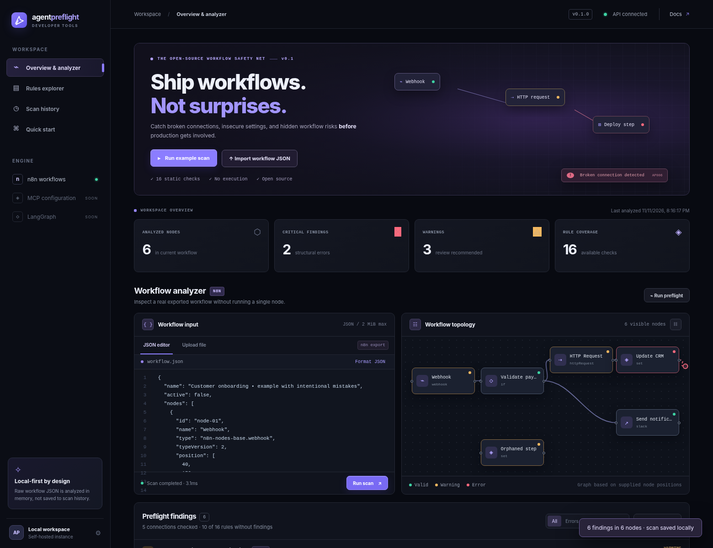
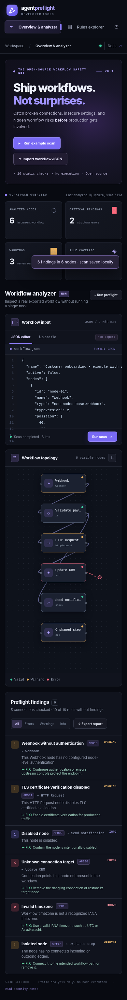

# Reproduce the working demo

The dashboard screenshot was captured from the included web UI using a locally running v0.1.0 backend and `fixtures/demo-workflow.json`.

## Steps

1. Run `npm install` (once), then `npm run dev` from the project root.
2. Open **http://127.0.0.1:8787**.
3. Click **Run example scan**.
4. Observe the six-node graph and the diagnostics panel.
5. Click **Rules explorer** to view all 16 rule definitions.
6. Click **Scan history** to reload the stored report; the original uploaded JSON is **not** retained.
7. Try **Export report**, then import a different n8n workflow JSON file.

The bundled demo fixture intentionally includes an unauthenticated webhook, a request with TLS verification disabled, a disabled node, a dangling connection, an invalid timezone, and an isolated node. The engine reports **2 errors, 3 warnings, and 1 informational finding** for that fixture in v0.1.0.

## Screenshots

These images are actual browser renders of the shipped source, not invented metrics or screenshots from a production service.

## Public demo status

No permanent public demo has been deployed by this repository package. To provide a public interactive demo, first add authentication, abuse protection, upload isolation and deployment hardening, or create a **separate browser-only analyzer** that does not expose the prototype HTTP API. Do not treat a static GitHub Pages screenshot as a live backend.
